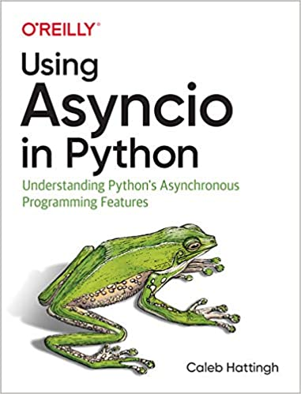

# Using Asyncio in Python — Learner Guide

[All books](../README.md)

## The Book in One Minute

**Main question:** how do you run many I/O-bound tasks concurrently on one thread without the bugs that threads invite?

**Answer:** use cooperative multitasking. Coroutines yield control at `await`, so an event loop can interleave thousands of waiting tasks while keeping the switch points visible in the source.

**Mental model:** one event loop drives many coroutines. Each `await` is a point where another task may run. Nothing between two suspension points on the same loop is interleaved, but an invariant that spans an `await` can still race.

**Coverage note:** these notes follow Caleb Hattingh's book (chapters 1–5 plus the history appendix). They mix book-era material with later additions such as `asyncio.TaskGroup`, `asyncio.timeout`, and `asyncio.to_thread` (Python 3.11+/3.9+); version notes flag these where identified.

## Quick Route (About 30–45 Minutes)

1. [Ch. 1: Introducing asyncio](chapter-01-introducing-asyncio-summary.md) — what cooperative multitasking buys you, and what it does not.
2. [Ch. 2: The truth about threads](chapter-02-truth-about-threads-summary.md) — why race conditions motivate visible suspension points.
3. [Ch. 3: Asyncio walk-through](chapter-03-asyncio-walkthrough-summary.md) — the core API you actually use day to day.
4. [Ch. 4: Libraries and case studies](chapter-04-asyncio-libraries-summary.md) — applying it with Streams, queues, and real clients.
5. [Ch. 5: Concluding thoughts and history](chapter-05-concluding-thoughts-and-history-summary.md) — how the syntax evolved and where to go next.

Chapter 3 is the technical heart; spend the most time there. Treat Chapter 4 as a menu of patterns, not a reading assignment.

## Chapter Map

| Chapter | What to retain |
|---|---|
| [1 — Introducing asyncio](chapter-01-introducing-asyncio-summary.md) | Asyncio targets high-concurrency I/O; it does not speed up CPU work, replace threads, or remove all races |
| [2 — The truth about threads](chapter-02-truth-about-threads-summary.md) | Threads suit blocking I/O and GIL-releasing native work; read-modify-write across a switch is the classic race |
| [3 — Asyncio walk-through](chapter-03-asyncio-walkthrough-summary.md) | Coroutines, the event loop, tasks/futures, `async with`/`async for`, and clean startup/shutdown |
| [4 — Libraries and case studies](chapter-04-asyncio-libraries-summary.md) | Streams, decoupling with `asyncio.Queue`, aiohttp, ØMQ, asyncpg, and Janus for thread bridging |
| [5 — Concluding thoughts and history](chapter-05-concluding-thoughts-and-history-summary.md) | `async`/`await` is syntax built on generators; lean on framework APIs over raw internals |

## Do Not Confuse

- **Coroutine function vs. coroutine object:** calling an `async def` returns a coroutine object; it does not run until awaited or scheduled as a task.
- **Visible switch points vs. no races:** tasks only switch at `await`, but shared state touched across an `await` can still need `asyncio.Lock`. Thread and external-resource races also remain.
- **Thread offloading vs. CPU parallelism:** `run_in_executor(None, fn)` and `asyncio.to_thread(fn)` use a thread pool, good for blocking I/O. CPU-bound Python still needs a process pool on GIL-enabled CPython.
- **`create_task` vs. `ensure_future`:** prefer `create_task` in application code; `ensure_future` is a framework utility.
- **Bounded vs. unbounded queues:** an unbounded `asyncio.Queue` turns a slow consumer into growing memory. Bound it and choose a policy for when it fills.

## Practice (10–20 Minutes)

Build a bounded worker pool with the standard library only. Notice the visible suspension point (`await asyncio.sleep(0)`) and the backpressure from a bounded queue:

```python
import asyncio

async def worker(name, queue, results):
    while True:
        item = await queue.get()
        try:
            if item is None:
                return
            await asyncio.sleep(0)          # visible suspension point
            results.append((name, item))
        finally:
            queue.task_done()

async def main():
    queue = asyncio.Queue(maxsize=2)        # bounded: backpressure
    results = []
    workers = [asyncio.create_task(worker(i, queue, results)) for i in range(3)]
    for item in range(6):
        await queue.put(item)
    await queue.join()                      # wait until all items processed
    for _ in workers:
        await queue.put(None)               # one poison pill per worker
    await asyncio.gather(*workers)
    return results

out = asyncio.run(main())
assert sorted(item for _, item in out) == list(range(6))
print("processed:", sorted(item for _, item in out))
```

Then: remove `await queue.join()` and explain what can go wrong at shutdown. Replace `maxsize=2` with `0` (unbounded) and describe the memory behavior if producers outrun consumers. On Python 3.11+, rewrite the worker pool with `asyncio.TaskGroup` and compare the cancellation behavior.

## Self-Check

1. What does calling an `async def` function return before you await it?
2. Why is a read → `await` → write sequence still unsafe without a lock?
3. When should you reach for `run_in_executor`/`asyncio.to_thread` instead of a coroutine?
4. What does `asyncio.run()` do with pending tasks at shutdown?

**Answer cues:** a coroutine object (not a result or a future); another task can run during the `await` and change shared state; for blocking or non-async code so it does not freeze the loop; it cancels pending tasks, gathers them with `return_exceptions=True`, then closes the loop.

**Next:** [Effective Python, Ch. 7](../effective-python/chapter-07-concurrency-and-parallelism-summary.md) to compare threads, processes, and coroutines, or [High Performance Python, Ch. 10](../high-performance-python/chapter-10-multiprocessing-summary.md) when the bottleneck is CPU-bound.

---

## About This Project

This directory also contains runnable examples from [Caleb Hattingh](https://github.com/cjrh)'s O'Reilly book [Using Asyncio in Python: Understanding Python's Asynchronous Programming Features](https://www.oreilly.com/library/view/using-asyncio-in/9781492075325/).



**Note:** Some of the examples have been slightly modified to be more easily runnable.
